# Gas bottle detection for Primagaz: progress report

Group Farsight (AI Applications, UCLL) - members: _(fill in)_

## 0. Summary

- **Setup we work toward** (section 1): a fixed camera station on the conveyor in a Primagaz plant that detects,
  tracks and counts every bottle and later sorts out other brands and damaged bottles.
- **Pretrained YOLO** finds people and cars, but has no class for gas bottles ("toilet", "vase", "bowl"...).
- **We fine-tuned YOLO11n** (the smallest model) on free datasets with gas bottles plus 245 photos we labeled ourselves:
  - model A: only CylinDeRS (7,060 images), 1 hour of training on a laptop GPU
  - model B: CylinDeRS + Primagaz conveyor images + trucks from above + our own photos
- **Results on test images** (mAP50): Primagaz conveyor 0.97 (A) / 0.98 (B), CylinDeRS 0.89 / 0.89, trucks from above
  0.08 (A) / 0.97 (B).
- **Tracking + counting**: with a fixed camera and a counting line we counted 4 out of 4 bottles correctly. Counting
  unique track ids gives far too many. About 55 fps on a laptop GPU.
- **Main issues**: no real Primagaz video, the same bottle in train and test in an existing dataset, file paths too
  long for Windows, labels that needed fixing, a domain gap between datasets.
- **Conclusion so far**: detecting and counting bottles looks promising, but we need real data from Primagaz to know if
  it's good enough, and sorting by brand / damage still has to be tested.

## 1. Test setup (2nd iteration): what would a practical implementation look like?

### What we are working toward

An **automatic sorting station on the conveyor in a Primagaz filling plant**, right after the empty bottles are
unloaded from the trucks and before they get filled. Today people check the returned bottles by eye. A camera
system could do (part of) this:

1. **Detect and track** every bottle on the conveyor, so every bottle gets one id. This also gives a **count**
   (per truck, per hour).
2. For every bottle id, **decide**: is it a Primagaz bottle or a bottle of another brand ("wrong bottle")? Is it OK or
   damaged / too dirty / rusty ("NOK")? Later maybe also read the stamp on the collar (requalification year, tare
   weight).
3. A PLC uses the decision to **push the bottle to the right lane**: filling, foreign brands, or repair / scrap.
4. Everything is **logged** with a photo of every rejected bottle, so operators can check the decisions.

```
 truck unloading                 camera station (tunnel with LED light)                    lanes
 ===============>  conveyor  ===[ cam front ]===[ cam back ]===>  decision  ===> filling
                                       |               |             |  \===> other brands
                                       +---- edge PC (GPU): detect -> track -> classify -> PLC
                                                       \-> log + count + photos of rejects
```

### Practical choices

- **Cameras**: 2 cameras (front + back side of the bottle), because the logo or the damage can be on either side.
  1080p at 30 fps, preferably global shutter against motion blur. The earlier group's images (`gasoknok`) were also
  taken from several sides (`front`, `back_left`, `back_right` in the file names).
- **Light**: a small tunnel with diffuse LED light, so daylight, shadows and reflections on wet bottles (after
  washing) don't change the images too much.
- **Computer**: an edge computer with a GPU (e.g. an industrial PC or a Jetson) next to the line. An LPG filling plant
  has explosion-risk zones (ATEX), so the hardware has to be ATEX-certified or placed outside the zone (camera
  behind a window, cable to the PC). This is a big practical point we need to ask Primagaz about.
- **Speed**: the filling line in the Petrogal video handles 1,200 bottles per hour, so one bottle every 3 seconds.
  At 30 fps a bottle is visible in tens of frames, so the system can combine several frames per bottle.
- **Counting**: with a fixed camera, a bottle is counted when it crosses a line on the conveyor (see 3.6).
- **License**: Ultralytics YOLO is open source under AGPL-3.0. For a closed commercial system at Primagaz an
  Ultralytics enterprise license is needed (or another model).

### What we build in this course (software-only prototype)

We don't have access to a plant, so our prototype works **offline on recorded videos and images**:
`video -> YOLO detection (gas_bottle) -> tracker (ByteTrack) -> count unique ids -> output video + numbers`.
Classification (brand, OK/NOK) per tracked bottle is the next step.

### How we would test it

- **Model level** (per image): mAP50, mAP50-95, precision and recall from the Ultralytics validation on test images
  that the model never saw during training. Important: test images have to look like the real situation
  (Primagaz bottles on a conveyor), and the same bottle must never be in both train and test.
- **System level** (per bottle, what Primagaz cares about): record a few minutes of conveyor video, count the bottles
  by hand and mark the foreign / damaged ones (ground truth). Run the pipeline and compare: missed bottles, double
  counts, wrong decisions.
- **Test conditions**: normal and maximum line speed, bottles touching each other, dirty / wet / rusty bottles,
  all bottle types and colours, day and night light.

## 2. Performance criteria (2nd iteration)

The numbers are our proposal; Primagaz has to tell us what is acceptable for them (see questions).

| Criterion | Why it matters for Primagaz | How we measure it | Proposed target |
|---|---|---|---|
| Bottle detection (recall per bottle) | a bottle that isn't seen isn't checked, so a foreign or damaged bottle could get filled | bottles detected / bottles that passed (video) | >= 99.5 % |
| Counting accuracy | stock and truck loads must match | counted vs. hand count, per truck / per 15 min | error <= 0.5 % |
| Foreign bottle detection | filling another company's bottle is not allowed | wrong bottles caught / all wrong bottles | >= 99 % |
| False rejects | every good bottle that is pushed out costs manual work | good bottles rejected / good bottles | <= 1-2 % |
| Speed | has to keep up with the line (1,200 bottles/h = 1 bottle every 3 s) | frames per second on the target hardware, delay until decision | >= 25 fps per camera, decision < 1 s |
| Tracking stability | an id switch = a bottle counted twice | id switches per 100 bottles | ~0 |
| Robustness | dirt, rust, water, light changes, all bottle types | same metrics, per test condition | no big drop per condition |
| Safety, privacy, cost | ATEX zones, workers on camera (GDPR), budget | checklist with Primagaz | must be OK before a pilot |
| Maintenance | new bottle types will come | how many labeled images are needed to add a type, who labels | a few hundred images per new type |

For developing the model we use the Ultralytics metrics (precision, recall, mAP50, mAP50-95). These are measured
per image, while Primagaz cares about per bottle. A bottle is seen in many frames, so a model with 95 % recall per
frame can still catch (almost) every bottle when it is tracked over several frames.

## 3. Progress on bottle detection

We followed the steps from the assignment: first play with the pretrained YOLO models, then tracking, then fine-tuning
on gas bottles with existing datasets, then labeling our own images and training again.

### 3.1 Pretrained YOLO (COCO) on images

We started with the smallest YOLO11 model (`yolo11n.pt`, pretrained on the COCO dataset with 80 classes) on 12 of our
gas bottle photos (`scripts/detect_imgs.py`).

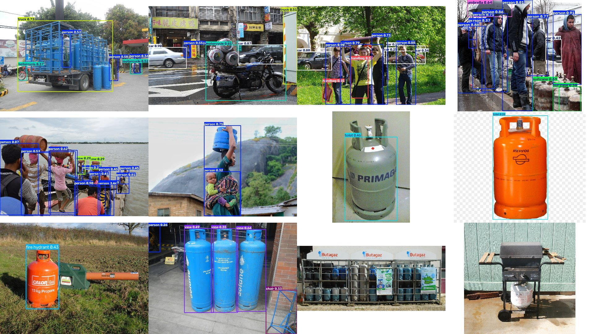

People (33x), cars (7x), motorcycles and trucks are found without problems. But COCO has **no class for gas bottles**,
so the bottles are found as something else or not at all: the Primagaz bottle is a "toilet" (0.46), the Calor bottle a
"fire hydrant" (0.43), the three Solane bottles are "vases", bottles next to people become "suitcases", and the
Butagaz bottle cage and the bottle under the BBQ are not found at all. So we have to fine-tune YOLO on gas bottles.

### 3.2 Tracking in a video (pretrained model)

We downloaded the two filling plant videos from MAKEEN Energy (see `docs/DATA.md`) and cut short clips of 12-20 s out
of them (`scripts/cut_clip.py`), because short clips keep the experiments fast. Then we ran YOLO + the ByteTrack
tracker (`scripts/track_videos.py`). Every object gets a track id that stays the same from frame to frame.

| FlexSpeed (Bolivia): tracking people | Petrogal (Portugal): bottles seen from above |
|---|---|
| 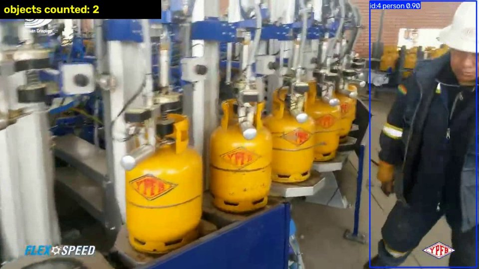 | 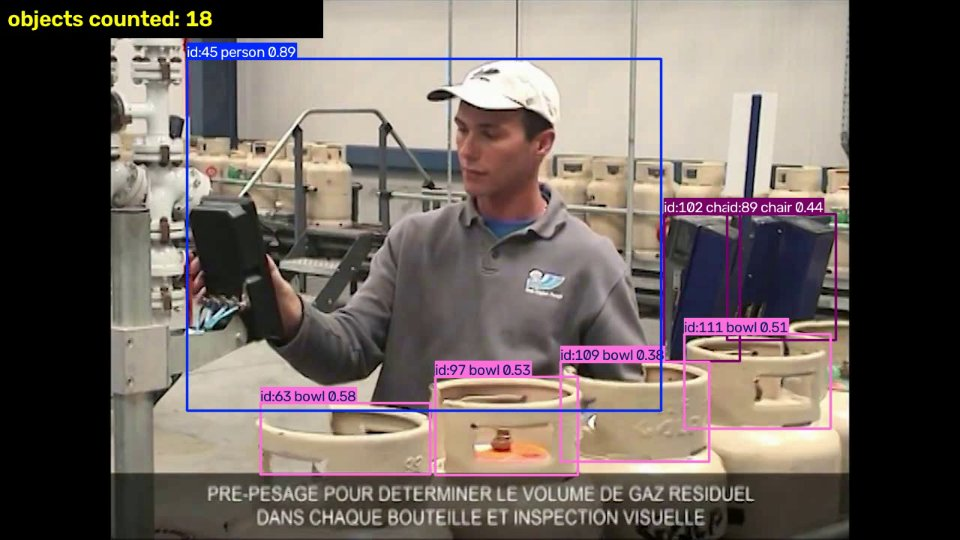 |

- Tracking people works well: the two workers that walk by get their own id and keep it (2 persons counted).
- In the Petrogal clip the tops of the gas bottles are detected as **"bowl"** and the machines as "chair" or "cell phone".
- Speed: about 18 ms per frame (54 fps) on our laptop GPU, including reading the video, drawing the boxes and saving
  the result. (When we ran it while a training was running on the same GPU it was only 32-37 fps.)

### 3.3 Fine-tuning YOLO on gas bottles (model A)

We fine-tuned `yolo11n.pt` on **CylinDeRS**, a public dataset of 7,060 images with 25,269 labeled gas cylinders
(`scripts/train.py configs/cylinders.yaml`): 60 epochs, image size 640, batch 16, all other settings default
(the optimizer AdamW was chosen automatically by Ultralytics). Training took **58 minutes** on our laptop
(NVIDIA RTX 3060 laptop GPU, 6 GB).

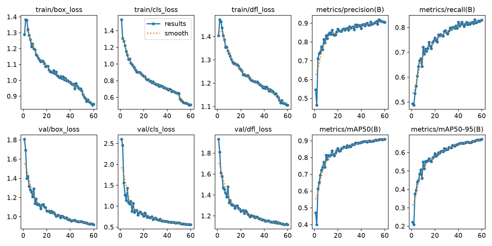

The losses go down and precision, recall and mAP go up nicely. The validation loss also keeps going down, so the model
is not overfitting. At epoch 60 the mAP is still going up a little bit, so more epochs would probably still help.
Best result on the validation set: **mAP50 = 0.909, mAP50-95 = 0.672** (precision 0.900, recall 0.832).

The authors of CylinDeRS report a test mAP of 0.910 with YOLO11m (a model that is about 8 times bigger, trained for 200
epochs). We get 0.894 mAP50 on the same test set with the nano model, so that's close.

### 3.4 Labeling our own images

We downloaded 599 freely licensed photos from Wikimedia Commons and sorted them by hand: 359 photos of LPG bottles
(the kind Primagaz sells), 102 photos of other gas cylinders and 138 unusable photos (see `docs/DATA.md`).

To label them faster we used **model-assisted labeling** (`scripts/autolabel.py`): model A predicts the boxes
(confidence >= 0.4) and we only check and correct them. This is the same idea as "Label Assist" in Roboflow or
"automatic annotation" in CVAT. Model A put 1,177 boxes on the 359 photos. We checked every photo:

| result of the check | photos | what we do with them |
|---|---|---|
| boxes OK | 245 (737 bottles) | used for training model B |
| bottles missed | 81 | correct by hand in Roboflow (to do) |
| wrong boxes | 33 | correct by hand in Roboflow (to do) |

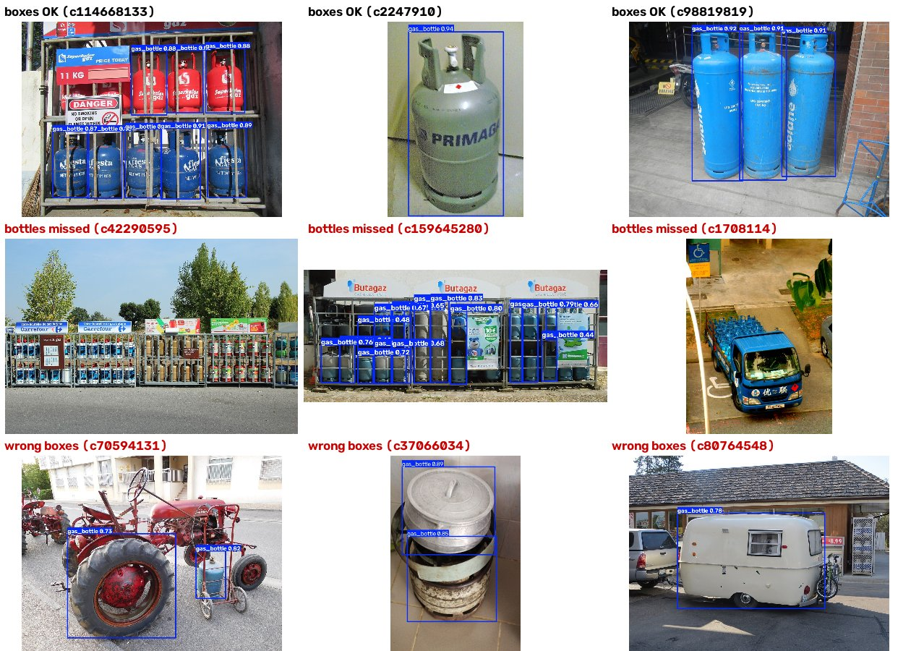

Missed bottles are mostly small bottles far away (bottle cages at petrol stations, trucks full of bottles), bottles in
the dark and old black-and-white photos. Wrong boxes are things that look a bit like a bottle: cooking pots, buckets,
yellow jerrycans, a tractor wheel, a caravan, fire extinguishers, and sometimes two boxes on one bottle. The result of
the check is in `data/commons/label_review.csv`.

### 3.5 Training on all data (model B)

For model B we started from model A and trained 40 more epochs on all our data together (`configs/combined.yaml`):

| data | train images | val images |
|---|---|---|
| CylinDeRS | 4,915 | 1,434 |
| Primagaz conveyor (gasoknok + Gas, our own split by bottle id) | 247 | 92 |
| Juntar (trucks seen from above) | 330 | 37 |
| our checked Commons photos | 245 | - |
| **total** | **5,737** | **1,563** |

The test images of every dataset were kept apart, so the test sets were never seen during training.

Training took 49 minutes. The curves look good again: the losses keep going down and the mAP is still going up a
little at epoch 40. Best result on the (combined) validation set: **mAP50 = 0.929, mAP50-95 = 0.663** (precision 0.930,
recall 0.868). This number can't be compared directly with model A, because the validation set is different. That's
why we compare both models on the same test sets in section 6.

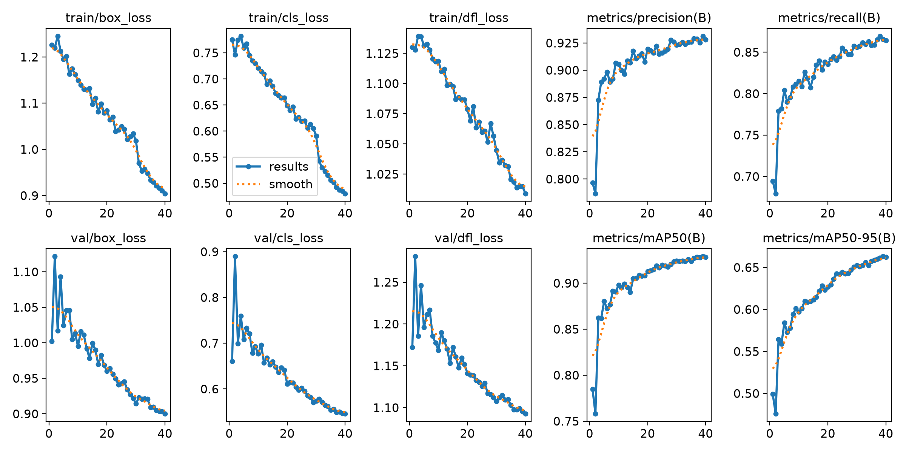

### 3.6 Tracking and counting gas bottles

With our own model, YOLO + ByteTrack now follows gas bottles in the videos (about 55 fps on the laptop GPU).
Counting is harder than it looks. We tried 2 ways:

1. **Count the unique track ids** (only ids that were seen at least 10 frames). This gives way too many bottles. In a
   20 s clip of the FlexSpeed conveyor we got 159 ids (82 counted). The camera is handheld and moves, bottles hide
   behind each other and every time the tracker loses a bottle it gets a new id, so the same bottle is counted again.
2. **Count the bottles that cross a line**, like a counter on a conveyor would do (`--line 0.44`).

To check the line counting we needed the right answer. We took a 12.5 s clip where the camera doesn't move: bottles
pass a check-weighing unit in the Petrogal plant. To count the bottles by hand we made a "slit-scan" image: we take the
column of pixels on the counting line from every frame and put them next to each other, so every bottle that passes the
line becomes one band. That gives **4 bottles** (the GALP bottle on the left was already over the line at the start).

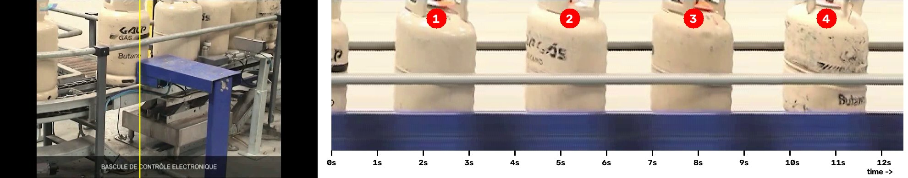

| counting method (model A) | result | correct? |
|---|---|---|
| bottles crossing the line | **4** (at 2.2 s, 5.1 s, 7.8 s and 10.8 s) | yes, same as our hand count (2.3 s, 5.2 s, 7.9 s, 10.8 s) |
| unique track ids (>= 10 frames) | 11 (15 ids in total) | no: also counts bottles that never pass the line + id switches |

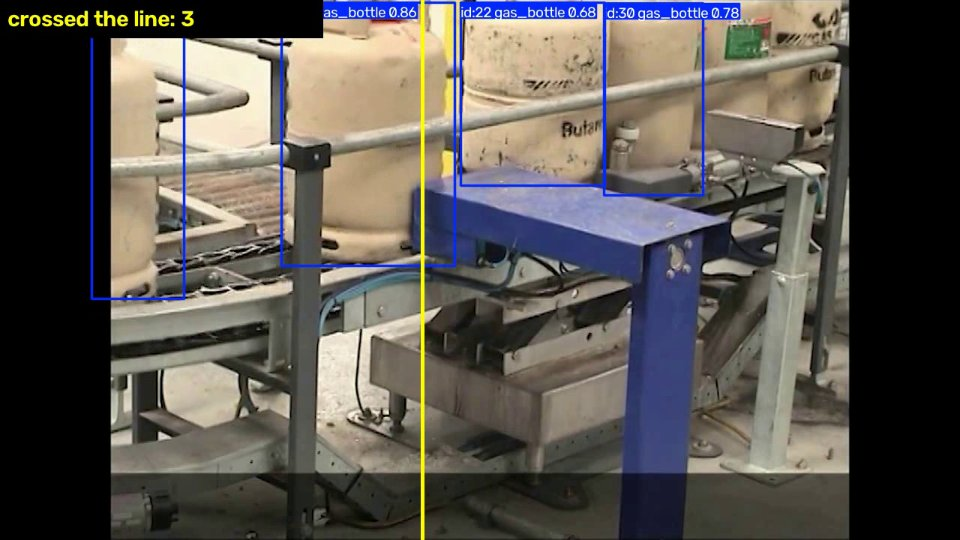

The tracker used 15 different ids in this clip, more than the number of bottles, so there are id switches (for example
when a bottle is hidden behind the railing or the blue frame it can come back with a new id). With the line this doesn't
matter, as long as the id doesn't switch exactly while the bottle crosses the line. One bottle passes every 2.8 s, that's about 1,290 bottles per hour, which
matches the 1,200 bottles/hour of this filling line (according to the video).

We did the same with model B:

| clip | camera | model A | model B |
|---|---|---|---|
| check-weigher, **bottles crossing the line** (hand count: 4) | fixed | **4** | **4** (same moments) |
| check-weigher, unique ids (>= 10 frames) | fixed | 11 (15 ids) | 13 (22 ids) |
| FlexSpeed conveyor, unique ids | handheld | 82 (159 ids) | 104 (258 ids) |
| FlexSpeed carousel, unique ids | handheld | 75 (130 ids) | 73 (127 ids) |
| Petrogal entry, unique ids | handheld + scene changes | 33 (61 ids) | 36 (53 ids) |

Model B also counts the 4 bottles correctly with the line. It finds more small bottles far away, so with a moving
camera it makes even more ids (258 in 20 s on the FlexSpeed conveyor, see the ids above 1,000 in the picture below).
For the handheld clips we don't know the real number of bottles, but these numbers are clearly much too high.

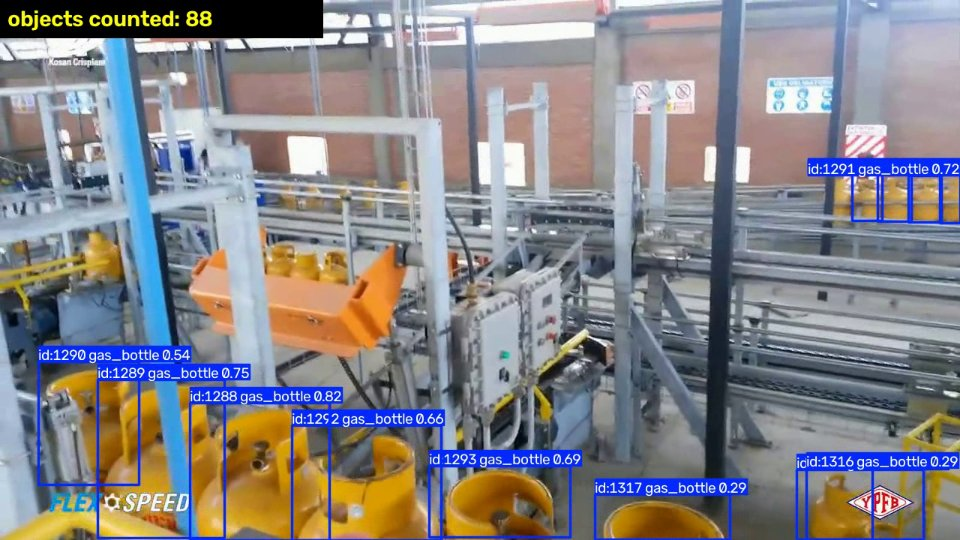

**Counting bottles on a truck.** The Juntar images show trucks from above, so we can also count all bottles on a truck
in one image. On the 26 test images (2,607 bottles) model B counts 2,622 bottles (confidence 0.4). Per truck the
count is on average **5.4 bottles wrong** (about 5 %), and the worst truck is 37 bottles off (120 real). Model A finds
almost nothing (3 bottles).

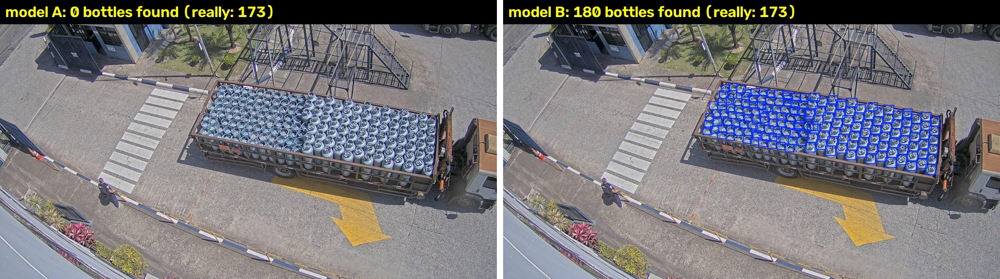

## 4. Which model did we use?

- **YOLO11n** from Ultralytics (version 8.4.175), the smallest YOLO11 model (2.6 million parameters), pretrained on
  COCO, fine-tuned by us on gas bottles with 1 class: `gas_bottle`.
- Tracker: **ByteTrack** (default tracker settings of Ultralytics).
- We chose the nano model because of hint 1 (work with small models) and because it trains in about 1 hour on our
  laptop. A bigger model (yolo11s / yolo11m) is something to try next.
- Our trained models are in `models/` (5 MB each), so the other group members can use them without training.

## 5. Which data did we use?

All classes of the datasets were changed into one class `gas_bottle`. Details and download links: `docs/DATA.md`.

| dataset | what | images | bottles (boxes) | license |
|---|---|---|---|---|
| CylinDeRS (Roboflow / research paper) | all kinds of gas cylinders, mostly industrial | 7,060 (4,915 / 1,434 / 711) | 25,269 | CC BY 4.0 |
| gasoknok + Gas (Roboflow) | **Primagaz** bottles on a conveyor, close-up, incl. other brands and damaged bottles | 523 (247 / 92 / 184) | 655 | CC BY 4.0 |
| Juntar (Roboflow) | security camera above trucks full of LPG bottles (Brazil) | 393 (330 / 37 / 26) | 42,739 | CC BY 4.0 |
| Wikimedia Commons | photos of LPG bottles, labeled by us | 359 (245 checked) | 737 checked | CC BY / BY-SA / CC0 / PD |
| MAKEEN Energy videos (YouTube) | LPG filling plants, for tracking tests only | 2 videos, 7 clips | - | YouTube, not in our repo |

(train / val / test)

The original split of the Primagaz images was not good: the same bottle (same id in the file name) was in train and in
test. We made our own split by bottle id, so a test bottle was never seen during training.

## 6. Performance reported by the Ultralytics tools

Precision, recall, mAP50 and mAP50-95 from `model.val()` on the **test sets** (never seen during training),
`scripts/evaluate.py`. mAP50 = mean average precision when a box counts as correct if it overlaps at least 50 % with the
real box; mAP50-95 is the average over stricter overlaps (50 % to 95 %), so it also looks at how precise the boxes are.

| test set | model | precision | recall | mAP50 | mAP50-95 |
|---|---|---|---|---|---|
| CylinDeRS (711 images, 2,270 bottles) | A (CylinDeRS only) | 0.872 | 0.814 | 0.894 | 0.654 |
| | B (all data) | 0.872 | 0.821 | 0.890 | 0.652 |
| Primagaz conveyor (184 images, 228 bottles) | A | 0.964 | 0.908 | 0.972 | 0.831 |
| | B | 0.917 | 0.956 | **0.980** | **0.873** |
| Juntar, trucks from above (26 images, 2,607 bottles) | A | 0.143 | 0.276 | 0.082 | 0.022 |
| | B | 0.937 | 0.932 | **0.971** | **0.662** |

Speed: the model needs about 2-4 ms per image on the laptop GPU (Ultralytics speed after training: 0.3 ms preprocess,
2.3 ms inference, 3.6 ms postprocess per image). The whole tracking pipeline runs at about 55 fps on a 720p video.

What we see:

- **CylinDeRS**: both models score the same, so adding the other data didn't make model B worse on the old data.
- **Primagaz**: both are very good, even model A that never saw a Primagaz bottle. Model B finds more bottles
  (recall 0.908 -> 0.956) and the boxes fit better (mAP50-95 0.831 -> 0.873), but it also makes a few more wrong boxes
  (precision 0.964 -> 0.917).
- **Juntar**: here the difference is huge, from 0.082 to 0.971 mAP50, with only 330 extra training images of this
  camera view. But the train and test images of Juntar come from the same few cameras at the same place, so this score
  is too optimistic for a new place or camera.

The training curves (`results.png`), the precision-recall and F1 curves and the confusion matrix of every training are
in `runs/<name>/`, the test plots in `runs/eval/`.

## 7. Issues we encountered

1. **The pretrained model doesn't know gas bottles.** COCO has no such class, so we got "toilet", "vase", "bowl",
   "fire hydrant" or nothing. Fine-tuning was necessary.
2. **Downloading from Roboflow with a script doesn't work.** The download link is behind a Cloudflare bot check, so
   `curl` gets an HTML page instead of a zip. Downloading in the browser works, and the Roboflow API works with your
   own API key (`scripts/download_roboflow.py`).
3. **Windows path length.** Some CylinDeRS images have file names of more than 150 characters. Together with our
   OneDrive folder that's more than the 260 characters Windows allows, so in our first training run Ultralytics
   skipped 292 images ("No such file or directory"). We only saw it in the warnings. We wrote `scripts/clean_export.py`
   to make the names shorter (turning on long paths in Windows also works).
4. **Mixed labels.** 3 label files of CylinDeRS (and 1 of gasoknok) mix polygons and boxes, Ultralytics then skips the
   whole image. `clean_export.py` turns the polygons into boxes.
5. **Every dataset uses other class names** (`gas_cylinder`, `gas_ok`/`gas_nok`, `p13-blue`, ...). We changed them all
   into `gas_bottle`.
6. **Same bottle in train and test** in the Primagaz images, which makes the test scores too optimistic. We made our
   own split by bottle id. For videos the same problem exists with frames of the same video (see `TODO`).
7. **Domain gap.** CylinDeRS has mostly industrial cylinders (oxygen, welding gas) in other places. Model A doesn't
   work at all on the images of trucks seen from above (Juntar): the bottles are tiny there and there are up to 270
   in one image.
8. **Counting with unique track ids gives way too many bottles** (id switches, bottles behind each other, moving camera,
   scene changes in the YouTube videos). Counting with a line works much better.
9. **No real Primagaz videos.** The YouTube videos are from other plants (Portugal, Bolivia), filmed with a handheld
   camera, with scene changes and subtitles. Only the earlier group's images (gasoknok) show Primagaz bottles.
10. **Model-assisted labeling is not perfect.** 114 of the 359 photos (32 %) still need manual corrections.
11. **Hardware.** 16 GB RAM was tight, we used only 2 data loader workers. Training model A took about 1 hour on the
    laptop GPU.

## 8. Findings

1. **A pretrained YOLO model is great for people and cars, but useless for gas bottles.** Fine-tuning fixes this, and
   it works well even with the smallest model on a laptop (about 1 hour of training).
2. **Finding one bottle in a close-up is easy.** Even model A, which never saw a Primagaz bottle, gets 0.97 mAP50 on
   the Primagaz conveyor images. The hard parts for Primagaz will be: many bottles close together, counting them
   correctly, and recognising *which* bottle it is (brand, OK / damaged). That last part we didn't test yet.
3. **The data is more important than the model.** 330 images of trucks from above took the score for that view from
   0.08 to 0.97, without making the rest worse. So for Primagaz we need images from their own line and cameras.
4. **The score depends completely on the test set.** The same model gets 0.97 on Primagaz close-ups, 0.89 on CylinDeRS
   and 0.08 on trucks from above. And with a bad split (the same bottle in train and test) the score looks better than
   it is. A mAP without saying on which data it was measured doesn't say much.
5. **Speed is not a problem.** About 2-4 ms per image for the model and about 55 fps for the whole tracking on a laptop
   GPU, while the line in the video needs about 1 bottle every 3 seconds.
6. **Counting needs a fixed camera and a counting line.** With a line we counted 4 out of 4 bottles correctly with both
   models. Counting unique track ids gave 11-13 instead of 4, and with a moving camera it's completely wrong.
   Counting all bottles on a truck from one camera above was about 5 % wrong per truck, so not good enough for an exact
   count (and bottles in a lower layer can't be seen from above).
7. **Is the technology ready to help Primagaz?** For detecting and counting bottles on a conveyor with a fixed camera
   it looks promising, but we only tested it on 12.5 seconds of video (4 bottles). To check the 99.5 % from section 2
   we need hours of real Primagaz video with a hand count. For sorting by brand or damage we don't know yet: that needs
   labeled examples from Primagaz (the earlier group's 30 images with damaged / wrong bottles are far too few).

## 9. Examples

- Pretrained model on images: `figures/pretrained_coco.jpg` (section 3.1)
- Tracking people with the pretrained model: `figures/track_coco_workers.jpg` (section 3.2)
- Model A on the Primagaz test images: almost every bottle found, also the BENEGAS bottles (other brand):

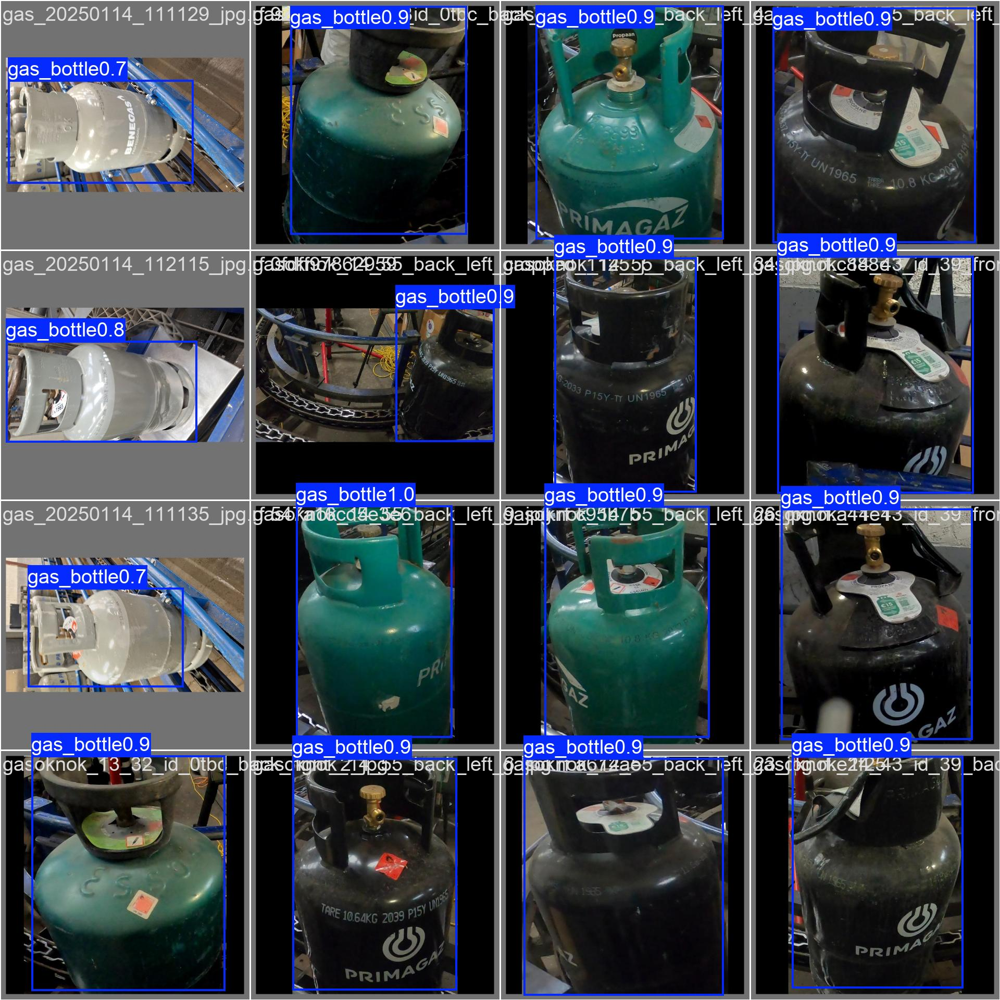

- Model A on the trucks seen from above (Juntar test images): almost nothing found (failure):

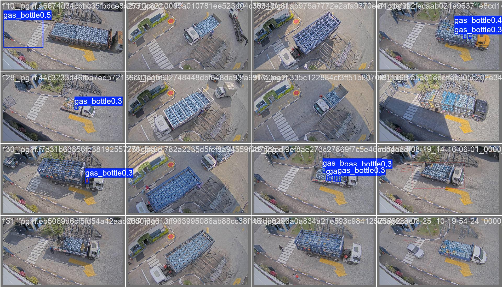

- Model B on the same truck: 180 bottles found, 173 really there (success): `figures/juntar_count_A_vs_B.jpg` (3.6)
- Counting bottles with a line, model B (success, 4 out of 4):

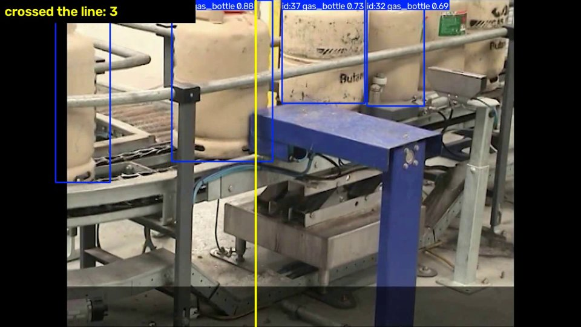

- Model B with a handheld camera: way too many track ids, so counting fails: `figures/track_flexspeed_modelB.jpg` (3.6)

- Videos: the tracking videos with boxes, ids and the counting line are in `runs/track_bottles/` and
  `runs/track_coco/` (not in git because of the size and because the clips come from MAKEEN Energy's YouTube videos).
  Run `scripts/track_videos.py` to make them again, or see our shared OneDrive folder.

## 10. Questions

### For Primagaz

1. Which problem is the most important for you: counting bottles (e.g. per truck), sorting out other brands, finding
   damaged / NOK bottles, or reading the stamp on the collar (year, tare)?
2. How fast are your lines (bottles per hour) and how far apart are the bottles on the conveyor? Do they touch?
3. Where could a camera be placed? Which zones in the plant are ATEX zones, and what is allowed there?
4. Which bottle types and brands come back on the line, and how many foreign bottles are there (roughly %)? What
   happens with them now?
5. What error rate is acceptable: what is worse for you, a foreign / damaged bottle that is not caught, or a good
   bottle that is pushed out?
6. Could we get (or record) videos and photos of your conveyor, and what are the rules for filming workers?
7. Do the current machines (e.g. from MAKEEN Energy / Kosan Crisplant) already do checks we should know about, and can
   a new system talk to your PLC?

### For the lecturer

1. The Roboflow workspace `gas` (datasets `gasoknok`, `Gas`, `ocr`) contains Primagaz bottles on a conveyor. Is this
   from an earlier group? May we reuse and extend it, and can we get their original videos?
2. Is model-assisted labeling (our model makes the boxes, we check and correct them in Roboflow) OK for the
   "label the images yourself" part?
3. Should we focus on detection + tracking + counting, or also on classification (brand, OK / NOK) this semester?
4. Is there a GPU server (or another option) for training bigger models, or is a laptop GPU fine?

## 11. Next steps

1. Correct the 114 Commons photos with missed / wrong boxes in Roboflow or CVAT (everyone takes a part) and train again.
2. Get real videos of a Primagaz line (ask Primagaz), and make a test set per video (not per frame).
3. Recognise *which* bottle it is: a classifier (OK / NOK, Primagaz / other brand) on the crops of the tracked bottles.
   The gasoknok images already have `gas_ok` / `gas_nok` labels (345 / 278 bottles).
4. Try bigger models (yolo11s, yolo11m) and more epochs, and a bigger image size or tiling for the small bottles on
   the trucks seen from above.
5. Compare the trackers (ByteTrack vs BoT-SORT) and tune their settings on a longer clip with a hand count.
6. Export the model (ONNX / TensorRT) and measure the speed on hardware that could stand next to a line.

## 12. How to run everything

```
python scripts/download_commons.py                       # Commons photos (already in the repo)
# Roboflow datasets: see docs/DATA.md (download in the browser or with scripts/download_roboflow.py)
python scripts/clean_export.py data/roboflow/cylinders   # also for gasoknok, gas, juntar
python scripts/prepare_primagaz.py
python scripts/to_one_class.py data/roboflow/juntar data/datasets/juntar

python scripts/detect_imgs.py data/commons/images --model yolo11n.pt                      # 3.1
python scripts/train.py configs/cylinders.yaml --model yolo11n.pt --epochs 60 --name cyl_y11n          # model A
python scripts/autolabel.py data/commons/images --model runs/cyl_y11n/weights/best.pt      # 3.4
python scripts/train.py configs/combined.yaml --model runs/cyl_y11n/weights/best.pt --epochs 40 --name combined_y11n  # model B
python scripts/evaluate.py models/gas_bottle_A_yolo11n.pt models/gas_bottle_B_yolo11n.pt

yt-dlp -f "mp4[height<=720]" https://youtu.be/UH-u0g3B8Pw -o data/videos/UH-u0g3B8Pw.mp4
python scripts/cut_clip.py data/videos/UH-u0g3B8Pw.mp4 4:42 4:54.5 data/videos/petrogal_checkweigher.mp4
python scripts/track_videos.py data/videos/petrogal_checkweigher.mp4 --model models/gas_bottle_B_yolo11n.pt --line 0.44
```

Python packages: `requirements.txt` (Ultralytics + PyTorch with CUDA).

## 13. Sources and credits

- Ultralytics YOLO11 docs: https://docs.ultralytics.com/ (AGPL-3.0 license)
- CylinDeRS: K. Stavrothanasopoulos et al., "CylinDeRS: A Benchmark Visual Dataset for Robust Gas Cylinder Detection and
  Attribute Classification in Real-World Scenes", Sensors 25(4), 1016, 2025 (https://doi.org/10.3390/s25041016),
  dataset on Roboflow Universe (CC BY 4.0)
- gasoknok and Gas datasets: Roboflow Universe, workspace "gas" (CC BY 4.0)
- Juntar dataset: Roboflow Universe, workspace "TestGasBottles" (CC BY 4.0)
- Photos from Wikimedia Commons: author and license of every photo in `data/commons/attribution.csv`
- Videos: MAKEEN Energy on YouTube, "Portugal: Petrogal LPG Cylinder Filling Plant (2013)" and "Bolivia: FLEXSPEED for
  Side-Entry Valves (2014)" (only used for testing, not shared in our repo)
